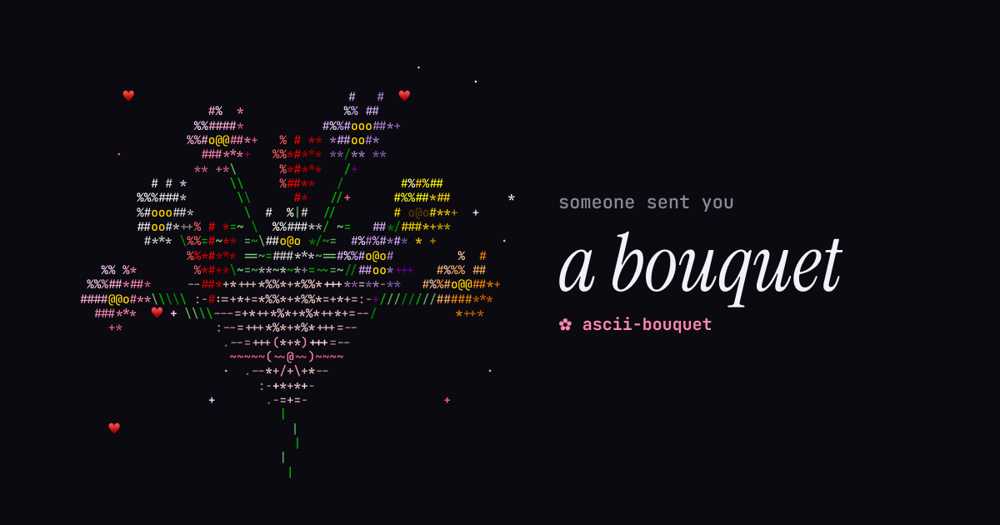

# ✿ ascii-bouquet

A spinning 3D bouquet made of text characters. Pick flowers, write a note, and send it as a link.

**Try it: [ascii-bouquet-beta.vercel.app](https://ascii-bouquet-beta.vercel.app)**



## Run it locally

You need Node.js 20 or newer.

```bash
git clone https://github.com/JakubSdf/ascii-bouquet.git
cd ascii-bouquet
npm install
npm run dev
```

Open http://localhost:5173.

```bash
npm test
```

## Open a bouquet in your terminal

```bash
curl -sN "https://ascii-bouquet-beta.vercel.app/t/<code>?cols=$(tput cols)&rows=$(tput lines)"
```

The share dialog shows the exact command for each bouquet.

## Credits

Based on [Ascii-Flower-Bouquet-](https://github.com/alishsharma17/Ascii-Flower-Bouquet-) by [@alishsharma](https://www.tiktok.com/@alishsharma). QR codes by [qrcode-generator](https://github.com/kazuhikoarase/qrcode-generator).

## License

MIT
